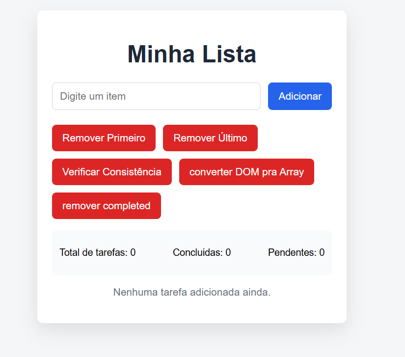

# Gerenciador de Tarefas em JavaScript
Este projeto é um gerenciador de tarefas desenvolvido em JavaScript puro, 
com foco em manipulação de estado, DOM e boas práticas de frontend.

O objetivo principal foi consolidar conceitos fundamentais de JavaScript 
sem o uso de frameworks, simulando o funcionamento de aplicações modernas.

## Funcionalidades

- Adicionar tarefas com validações
- Marcar e desmarcar tarefas como concluídas
- Editar tarefas com duplo clique
- Remover a primeira e a última tarefa
- Remover todas as tarefas concluídas
- Contadores automáticos:
  - Total de tarefas
  - Tarefas pendentes
  - Tarefas concluídas
- Persistência de dados com localStorage
- Suporte a teclado (Enter para adicionar tarefas)

## Tecnologias utilizadas

- HTML5
- CSS3
- JavaScript (ES6+)
- localStorage

## Tecnologias utilizadas

- HTML5
- CSS3
- JavaScript (ES6+)
- localStorage

## Conceitos aplicados

- Gerenciamento de estado com array de objetos
- Separação entre lógica de estado e renderização
- Manipulação do DOM baseada em estado
- Programação funcional com map, filter e some
- Persistência de dados no navegador
- Tratamento de eventos e validações de entrada

## Como executar o projeto

1. Clone o repositório
2. Abra o arquivo `index.html` em qualquer navegador moderno

## Observação

Este projeto foi desenvolvido com foco em aprendizado e consolidação de 
fundamentos de JavaScript, servindo como base para projetos mais complexos 
e aplicações full stack no futuro.

## Preview



## Falhas de armazenamento

Se o navegador impedir o acesso ao `localStorage` ou os dados salvos não tiverem
formato válido, o aplicativo mostra um aviso e continua funcionando em memória.
O conteúdo salvo não é apagado nem sobrescrito após essa falha. As alterações
feitas nessa sessão não persistem ao recarregar a página. Recuperar dados
corrompidos ou mesclar alterações entre abas não faz parte deste tratamento.

## Testes de regressão

Com Node.js 18 ou superior, execute:

```sh
node --test tests/*.test.cjs
node --check script.js
```

Os testes executam o script real com DOM simulado e armazenamento em memória,
sem acessar dados pessoais. Eles cobrem carregamento válido, JSON/formato
inválido, leitura bloqueada, falha de gravação e operações após a falha.
Não substituem testes em navegador nem comprovam o gesto nativo de duplo clique.
