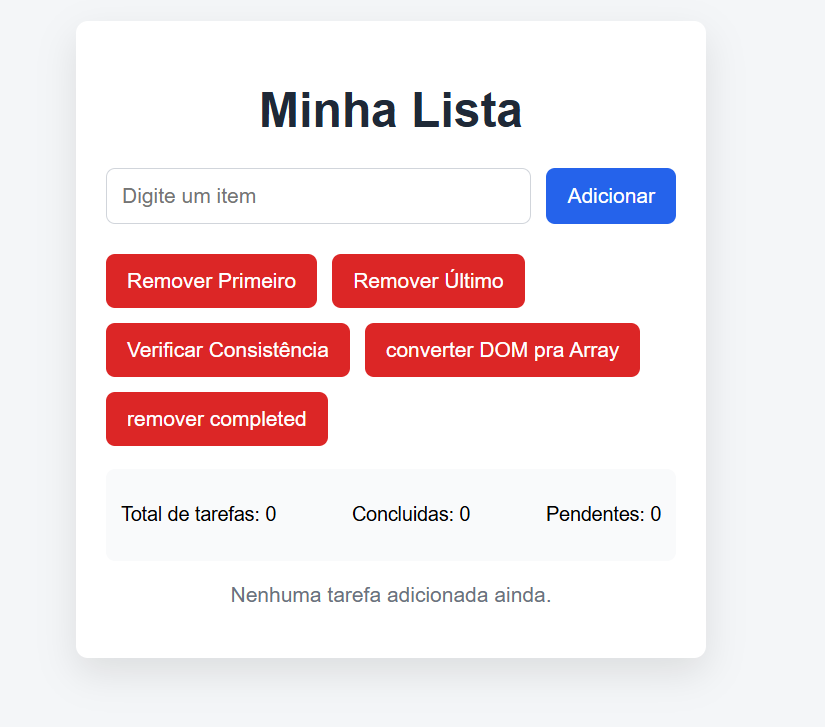

# Gerenciador de Tarefas em JavaScript
Este projeto é um gerenciador de tarefas desenvolvido em JavaScript puro, 
com foco em manipulação de estado, DOM e boas práticas de frontend.

O objetivo principal foi consolidar conceitos fundamentais de JavaScript 
sem o uso de frameworks, simulando o funcionamento de aplicações modernas.

## Funcionalidades

- Adicionar tarefas com validações
- Marcar e desmarcar tarefas como concluídas
- Editar tarefas com duplo clique
- Remover a primeira e a última tarefa
- Remover todas as tarefas concluídas
- Contadores automáticos:
  - Total de tarefas
  - Tarefas pendentes
  - Tarefas concluídas
- Persistência de dados com localStorage
- Suporte a teclado (Enter para adicionar tarefas)

## Tecnologias utilizadas

- HTML5
- CSS3
- JavaScript (ES6+)
- localStorage

## Tecnologias utilizadas

- HTML5
- CSS3
- JavaScript (ES6+)
- localStorage

## Conceitos aplicados

- Gerenciamento de estado com array de objetos
- Separação entre lógica de estado e renderização
- Manipulação do DOM baseada em estado
- Programação funcional com map, filter e some
- Persistência de dados no navegador
- Tratamento de eventos e validações de entrada

## Como executar o projeto

1. Clone o repositório
2. Abra o arquivo `index.html` em qualquer navegador moderno

## Como verificar esta versão

No checkout desta versão, a suíte está em `tests/task-edit.test.cjs`.

### Testes automatizados

Pré-requisito: Node.js instalado. Os comandos abaixo foram verificados com
Node.js 24.22.3. Execute na raiz do repositório:

```sh
node --version
node --test tests/task-edit.test.cjs
node --check script.js
```

Não é necessário rodar `npm install`: a suíte usa apenas módulos nativos do Node.
O comando `node --test` executa o script real com DOM e armazenamento simulados.
A suíte cobre criação/edição, normalização, duplicatas, limites de tamanho,
cancelamento e coerência de conclusão entre classes, contadores e dados salvos.
`node --check` confere sintaxe, não o comportamento da interface.

**Limite:** testes passando não comprovam o gesto nativo de duplo clique,
a aparência no navegador ou persistência real após recarregar. Não há etapa
de build ou lint configurada nesta branch. As suítes de outros PRs não estão
integradas a esta versão.

### Roteiro manual no navegador (pendente de execução)

Use um perfil de teste separado e somente tarefas fictícias, sem limpar o
armazenamento do perfil em que você mantém tarefas reais. Abra `index.html`
e comece com uma lista vazia no perfil de teste. Mantenha o mesmo navegador
e endereço durante a verificação: o comportamento de `localStorage` em
arquivos locais pode variar entre navegadores.

- [ ] Adicione `estudar` pelo botão e `treinar` com Enter. Espere total 2,
  pendentes 2 e concluídas 0.
- [ ] Clique uma vez em `estudar`. Confira a indicação de conclusão,
  pendentes 1 e concluídas 1. Clique novamente e confira a reversão.
- [ ] Dê um duplo clique nativo em `treinar` e informe ` Ler Livro `.
  Confira o título `ler livro`, a ordem dos itens e conclusão inalterada.
- [ ] Repita o duplo clique e cancele. Depois tente `ab` e ` ESTUDAR `.
  Cancelar deve preservar o título; os dois valores inválidos devem ser
  rejeitados, sem alterar a outra tarefa ou os contadores.
- [ ] Marque `ler livro` como concluída e recarregue. Confira os dois
  títulos, a ordem e concluídas 1. Se falhar, registre navegador, endereço
  e resultado observado; não conclua que persistência foi validada.
- [ ] Remova a primeira tarefa e confira o item restante; remova a última
  e confira total 0. Adicione uma tarefa fictícia novamente.

Registre resultado, navegador/versão e data para cada etapa. Este checklist
é um procedimento de validação, não evidência de que já foi executado.

## Observação

Este projeto foi desenvolvido com foco em aprendizado e consolidação de 
fundamentos de JavaScript, servindo como base para projetos mais complexos 
e aplicações full stack no futuro.

## Preview



## Testes de regressão

Requer Node.js 20 ou superior, sem dependências adicionais:

```sh
node --test tests/*.test.cjs
node --check script.js
```

Os testes executam o script real em um DOM simulado, cobrindo lista vazia,
ordem das tarefas, remoções e adição após o estado vazio. Não substituem
testes visuais em um navegador. O aviso de lista vazia não é uma tarefa
e não deve aparecer na conversão DOM → array nem causar falso alerta de inconsistência.
